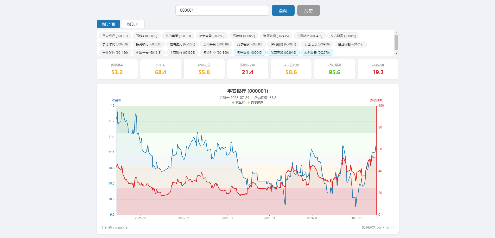

# A-Fear&Greed — A 股贪恐指数

> A 股个股 / ETF Fear & Greed Index · 多维度量化情绪分析工具

[](https://www.python.org/)
[](https://flask.palletsprojects.com/)
[](https://github.com/akfamily/akshare)
[](https://echarts.apache.org/)

<p align="center">
  
</p>

`a-fear-and-greed` 是一套面向 A 股的 **贪恐指数 (Fear & Greed Index)** 计算与可视化工具。
通过 6 项量化指标等权合成，将市场情绪浓缩为 `0 ~ 100` 的单一数值，
同时提供 **命令行** 和 **Web 应用** 两种使用方式，覆盖 A 股个股与主流 ETF。

---

## ✨ 特性

- 📊 **6 项指标等权合成** — 动量、RSI、成交量、波动率、相对强弱、换手热度
- 🔄 **双数据源高可用** —  `akshare` (东方财富)以及腾讯财经直连（免费，无需 token）
- ⚡ **多级缓存体系** — 内存 + 本地文件（`pickle`）
- 🌐 **Flask Web 服务** — 提供 RESTful API，前端使用 `ECharts` 实时绘图
- 🔍 **全量数据查询** — 支持 5000+ A 股、1500+ ETF 

---

## 📈 6 项指标说明

| # | 指标 | 算法 | 含义 |
|:-:|------|------|------|
| 1 | **价格动量** | 股价相对 50 日 / 125 日均线的平均偏离度 | 强势偏离 → 贪婪 |
| 2 | **RSI(14)** | Wilder 平滑 RSI，直接 clip 到 0-100 | 超买区 → 贪婪 |
| 3 | **成交量变化** | 20 日均量 vs 120 日均量的比值偏离 | 放量活跃 → 贪婪 |
| 4 | **历史波动率** | 30 日收益率滚动标准差 | 高波动 → 追涨情绪 |
| 5 | **相对强弱 vs 沪深300** | 滚动 20 日超额收益 | 跑赢大盘 → 贪婪 |
| 6 | **换手热度** | 换手率 5 日均值 / 60 日均值（代理指标） | 高换手 → 市场关注度高 |

每项指标使用 **滚动 Min-Max 归一化** 映射到 `0-100`，加权平均得到贪恐指数。

| 数值区间 | 情绪评级 |
|:--------:|----------|
| `0 - 25`  | 🔴 极度恐惧 |
| `25 - 45` | 🟠 恐惧 |
| `45 - 55` | ⚪ 中性 |
| `55 - 75` | 🟢 贪婪 |
| `75 - 100`| 🟩 极度贪婪 |

---

## 🛠️ 技术栈

| 模块 | 技术 |
|------|------|
| 后端 | Python 3.11+, Flask, pandas, numpy, akshare, requests |
| 前端 | HTML5 + ECharts 5.x (CDN) + localStorage |
| 数据源 | akshare (东方财富), 腾讯财经直连 (`web.ifzq.gtimg.cn`) |
| 缓存 | pickle 序列化 |
| 命令行 | matplotlib (双轴图 + TkAgg) |

---

## 📦 安装

```bash
# 1. 克隆项目
git clone https://github.com/PyDrifter/a-fear-and-greed.git
cd a-fear-and-greed

# 2. 创建并激活虚拟环境 (推荐)
python -m venv venv
venv\Scripts\activate        # Windows
# source venv/bin/activate   # Linux / macOS

# 3. 安装依赖
pip install -r requirements.txt
```

> 推荐 Python 3.11+，Windows 系统需安装中文字体（如 `SimHei` / `Microsoft YaHei`）以正确渲染 matplotlib 中文标签。

---

## 🚀 使用方式

### 1. 命令行模式 — `cal_a_greed.py`

```bash
# 单只股票
python cal_a_greed.py 600519           # 贵州茅台

# 多只股票
python cal_a_greed.py 600519 510050 159915

# 运行预设列表
python cal_a_greed.py --stocks         # 全部预设个股 (20 只)
python cal_a_greed.py --etfs           # 全部预设 ETF  (10 只)
python cal_a_greed.py --all            # 个股 + ETF 全跑
python cal_a_greed.py --help           # 帮助
```

运行后会在控制台打印各子指标数值，并弹出 **收盘价 + 贪恐指数双轴图**。

### 2. Web 服务模式 — `web_app.py`

```bash
python web_app.py
# 访问: http://127.0.0.1:5000
```

浏览器打开首页后：

1. 在搜索框输入 6 位代码回车，或点击预设标签；
2. 页面展示最新贪恐指数、6 项子指标卡片、近 1 年双轴图表；
3. 非预置代码搜索成功后，会自动追加到对应标签区（个股 / ETF），刷新不丢失。

### 3. MA5 偏离度预警 — `ma_warn.py` + GitHub Actions

`ma_warn.py` 定期检查若干标的（个股 / ETF）最新收盘价相对 **5 日均线 (MA5)** 的偏离度，
若偏离超过设定阈值，则通过**企业微信群机器人**推送预警消息。数据源为腾讯财经直连。

> 仅依赖 `requests`，便于在轻量 CI / 定时任务中运行。

#### 配置

配置来源优先级：**真实环境变量 > 项目根目录 `.env` > `config.ini`**。

- `.env`（本地运行推荐，复制 `.env.example`）：

```ini
WECHAT_WEBHOOK=https://qyapi.weixin.qq.com/cgi-bin/webhook/send?key=your_key_here
STOCK_LIST={"159552": 4, "588000": 4.5}
```

  - `WECHAT_WEBHOOK` — 企业微信群机器人 Webhook 完整地址（含 key）。
  - `STOCK_LIST` — JSON 字典，`{"标的代码": 预警阈值%}`。偏离度取绝对值判断：最新价高于 **或** 低于 MA5 超阈值都会预警。


#### 本地运行

```bash
copy .env.example .env        # Windows；先填写真实 key 与 STOCK_LIST
python -X utf8 ma_warn.py     # 建议用 -X utf8 避免 Windows GBK 中文乱码
```

#### 通过 GitHub Actions 定时运行

- **定时**：工作日 15:30（北京时间 = 07:30 UTC）运行。
- **手动**：Actions 页面 → `MA5 偏离预警` → `Run workflow`。

配置仓库 Secrets（Settings → Secrets and variables → Actions）：

| Secret | 说明 | 示例值 |
|:--|:--|:--|
| `WECHAT_WEBHOOK` | 企业微信机器人完整 URL | `https://qyapi.weixin.qq.com/...?key=xxx` |
| `STOCK_LIST` | 标的与阈值 JSON | `{"159552": 4, "588000": 4.5}` |

> 未配置 secret 时 run 会失败（脚本读取不到 Webhook），请务必先配置再使用定时任务。

---

## 🗂️ 项目结构

```
a-fear-and-greed/
├── cal_a_greed.py          # 核心计算类 A_FearGreed + 命令行入口
├── web_app.py              # Flask Web 服务 + API 路由
├── ma_warn.py              # MA5 偏离度预警 (企业微信推送)
├── .env.example            # ma_warn 本地运行环境变量模板
├── .github/
│   └── workflows/
│       └── ma_warn.yml     # MA5 预警定时任务 (工作日 15:30 北京)
├── templates/
│   └── index.html          # 前端页面 (ECharts + localStorage)
├── cache/                  # 本地缓存目录 (自动生成, 可删除重建)
│   ├── raw_{code}.pkl      # 原始日线数据 (cal_a_greed 用)
│   ├── {code}.pkl          # 计算结果 (web_app 用)
│   ├── name_{code}.pkl     # 单只代码名称
│   ├── all_stock_names.pkl # A 股全量名称表 (~5500 条)
│   └── all_etf_names.pkl   # ETF 全量名称表 (~1500 条)
└── venv/                   # Python 虚拟环境
```

---

## 💾 缓存机制

### 收盘时间感知 (`_market_cache_date`)

所有缓存键均基于北京时间动态决定日期：

| 当前北京时间 | 缓存日期 |
|-------------|---------|
| 交易日 收盘前 (`< 15:00`) | 昨天 (`YYYYMMDD`) |
| 交易日 收盘后 (`>= 15:00`) | 今天 (`YYYYMMDD`) |
| 周末 | 上一个工作日 (周五) |

### 多级缓存

| 类型 | 文件 | 内存命中 | 文件命中 | 回源 |
|------|------|:---:|:---:|------|
| 原始日线 | `raw_{code}.pkl` | ✓ | ✓ | akshare → 腾讯 |
| 计算结果 | `{code}.pkl` | — | ✓ | 实时计算 |
| A 股名称表 | `all_stock_names.pkl` | ✓ | ✓ | `ak.stock_info_a_code_name()` |
| ETF 名称表 | `all_etf_names.pkl` | ✓ | ✓ | `ak.fund_etf_spot_em()` |
| 单只名称 | `name_{code}.pkl` | — | ✓ | 单只查询 |

清理缓存：

```bash
# 命令行删除整个 cache 目录
rm -rf cache/

# 或通过 API
curl "http://127.0.0.1:5000/api/clear_cache"           # 清全部
curl "http://127.0.0.1:5000/api/clear_cache?code=600519" # 清单只
```

---

## 🌐 API 接口

所有接口均返回 JSON。

### `GET /api/fear_greed?code=<6位代码>`

计算并返回贪恐指数及近 1 年历史序列。

```json
{
  "code": "600519",
  "name": "贵州茅台",
  "date": "2026-07-29",
  "latest_fear_greed": 58.3,
  "latest_close": 1680.5,
  "indicators": {
    "价格动量": 62.1,
    "RSI(14)": 55.0,
    "成交量变化": 48.7,
    "历史波动率": 70.2,
    "相对强弱": 51.3,
    "讨论热度": 44.9
  },
  "series": {
    "date": [1722268800000, ...],
    "close": [1600.0, ...],
    "fear_greed": [50.1, ...]
  }
}
```

### `GET /api/stock_name?code=<6位代码>`

查询真实股票 / ETF 名称。

```json
{ "name": "贵州茅台" }
```

### `GET /api/clear_cache[?code=<代码>]`

清理缓存。不传 `code` 则清理全部。

---

## 🎨 Web 界面预览

打开 `http://127.0.0.1:5000` 即可看到：

- 顶部搜索栏 + 个股 / ETF 预设标签
- 贪恐指数卡片 + 6 项子指标
- 近 1 年 **收盘价 + 贪恐指数** 双轴图（ECharts 交互缩放）
- 背景色分区：红区 (极度恐惧) → 绿区 (极度贪婪)

---

